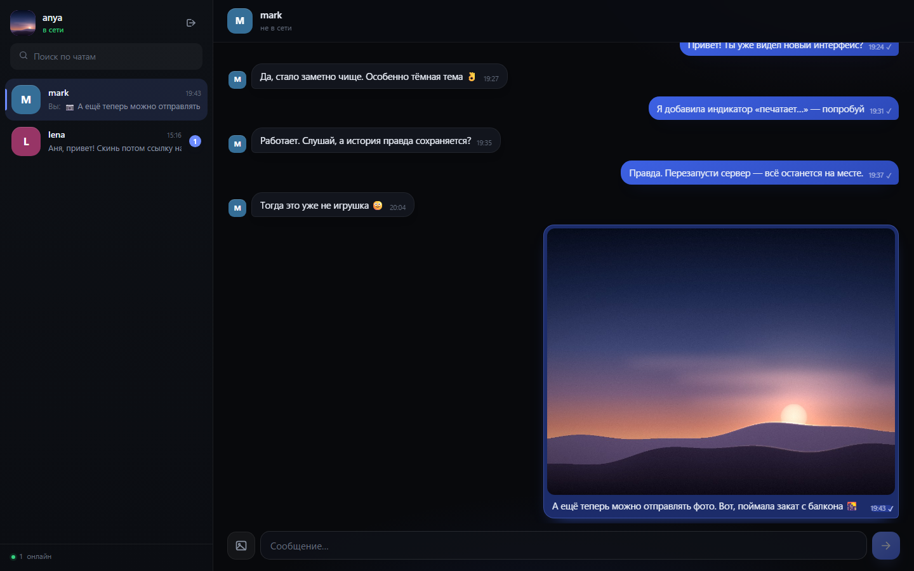

# Волна

Маленький мессенджер, который живёт на твоём компьютере: личные чаты, история сообщений,
фотографии, онлайн-статусы, индикатор «печатает…», отметки о прочтении. Тёмный минималистичный интерфейс.



## Запуск

Двойной клик по **`start.cmd`** — поднимутся оба сервиса и откроется браузер на `http://127.0.0.1:8787`.

Или вручную из папки проекта:

```bash
node server.js          # чат на 8787 + фото-сервер на 8788 (запускается сам)
PORT=9000 node server.js
MEDIA_EXTERNAL=1 node server.js   # фото-сервер уже запущен отдельно
```

Нужен Node.js 22.5+ (используется встроенный `node:sqlite`). Никаких `npm install` — зависимостей нет.

## Демо-аккаунты

При первом запуске создаются три пользователя с паролем **`1234`**:

| Имя  | Что внутри                                     |
| ---- | ---------------------------------------------- |
| anya | переписка с mark, фото в чате и фото профиля   |
| mark | та же переписка с другой стороны               |
| lena | ожидает ответа                                 |

Открой два окна браузера (или обычное и приватное), войди как **anya** и как **mark** —
и переписывайся сам с собой в реальном времени, отправляй фотографии.

Быстрый вход в демо без формы: `http://127.0.0.1:8787/#demo`.

## Что умеет

- Личные переписки 1-на-1; история и фото переживают перезапуск сервера.
- Живая доставка сообщений через Server-Sent Events — без перезагрузки страницы.
- **Фотографии**: кнопка в поле ввода, `Ctrl+V` из буфера, превью перед отправкой, подпись к фото,
  просмотр на весь экран по клику, лента с «Фото» в превью чата.
- Приложение само уменьшает снимок до 1600 px по длинной стороне перед отправкой —
  быстрее загрузка, и заодно срезаются EXIF-метаданные.
- **Регистрация с фото профиля**; фото можно сменить позже — клик по своему аватару.
  Без фото показывается буква на цветном фоне.
- Онлайн-статус (зелёная точка, «в сети» / «не в сети»), индикатор «печатает…», ✓ / ✓✓.
- Непрочитанные: счётчик в списке чатов и в заголовке вкладки.
- Поиск по чатам, группировка сообщений, разделители дат, подгрузка ранней истории,
  звук на новое сообщение, авто-скролл.
- Пароли — scrypt с солью, сессии в токенах, вход/выход.
- Адаптив: на телефоне список чатов и переписка — два экрана с кнопкой «назад».

## Как устроено

Два независимых процесса на одной базе:

```
messenger/
├─ server.js          чат: REST API + SSE + раздача интерфейса (порт 8787)
├─ media.js           фото: приём, проверка, хранение и отдача картинок (порт 8788)
├─ db.js              общая схема SQLite и мягкие миграции для обоих сервисов
├─ public/
│  ├─ index.html      экран входа/регистрации и экран чата
│  ├─ style.css       тёмная тема, пузыри с фото, лайтбокс, адаптив
│  ├─ app.js          клиент: состояние, рендер, EventSource, сжатие фото
│  └─ icon.svg
├─ assets/            демо-фото для переписки (генерируется скриптом)
├─ data/
│  ├─ volna.db        пользователи, сессии, сообщения, метаданные фото
│  └─ media/<id>      сами картинки (имя = случайный id)
├─ tools/smoke.mjs    46 проверок API и фото-сервера
├─ tools/shot.mjs     скриншоты интерфейса через headless Chrome/Edge (CDP)
├─ tools/make-demo-photo.py  генерация демо-фотографии
├─ screenshots/       скриншоты для README
└─ start.cmd          запуск в один клик (Windows)
```

`server.js` сам запускает `media.js` дочерним процессом и гасит его при выходе,
так что «один клик» поднимает оба сервиса. Клиент узнаёт адрес фото-сервера из `/config.js`,
поэтому перенос на другой порт или хост — это одна переменная окружения.

Почему фото-сервер отдельный: у него другой профиль нагрузки (мегабайты вместо килобайт),
свои лимиты и свой кэш. Он умеет отдавать файлы с `immutable`-кэшем, а типы проверяет
по сигнатуре байтов, а не по расширению — под видом картинки нельзя прислать что-то другое.

### API чата (порт 8787)

| Метод  | Путь                                    | Что делает                          |
| ------ | --------------------------------------- | ----------------------------------- |
| POST   | `/api/auth/register`                    | создать аккаунт → токен             |
| POST   | `/api/auth/login`                       | войти → токен                       |
| POST   | `/api/auth/logout`                      | закрыть сессию                      |
| GET    | `/api/me`                               | кто я и кто сейчас онлайн           |
| PATCH  | `/api/me`                               | сменить фото профиля                |
| GET    | `/api/users`                            | чаты: превью, время, непрочитанные  |
| GET    | `/api/messages?userId=&before=&limit=`  | история с собеседником (постранично)|
| POST   | `/api/messages`                         | отправить текст и/или фото          |
| POST   | `/api/read`                             | отметить чат прочитанным            |
| POST   | `/api/typing`                           | «печатает…» (не сохраняется)        |
| GET    | `/api/events?token=`                    | SSE: message, typing, read, presence, profile |
| GET    | `/api/health`                           | живость сервера                     |
| GET    | `/config.js`                            | адрес фото-сервера для клиента      |

### API фото (порт 8788)

| Метод  | Путь             | Что делает                                             |
| ------ | ---------------- | ------------------------------------------------------ |
| POST   | `/api/media`     | принять картинку (сырые байты, не больше 8 МБ) → id    |
| GET    | `/f/<id>`        | отдать файл (кэш на год, ETag, HEAD)                   |
| GET    | `/api/media/<id>`| метаданные: тип, размер, ширина, высота                |
| GET    | `/health`        | сколько файлов и байт лежит                            |

Авторизация — заголовок `Authorization: Bearer <токен>` (для SSE токен в query, потому что
EventSource не умеет свои заголовки). Загружать фото может только вошедший пользователь,
и отправить в чат можно только своё фото.

## Проверка

```bash
node tools/smoke.mjs     # пока сервер запущен
```

46 проверок: регистрация и отказы доступа, отправка, непрочитанные, прочтения, пагинация,
SSE, загрузка фото, проверка типа по содержимому, отдача файла, фото-сообщение, запрет чужого
фото, аватар, превью чата.

Скриншоты для проверки вёрстки без браузера:

```bash
node tools/shot.mjs http://127.0.0.1:8787/#demo out.png --size=1440x900 --click=.chat-item
```

## Границы

Это локальный инструмент, а не публичный сервис:

- оба сервера слушают только `127.0.0.1` и отдают обычный HTTP — без TLS;
- нет шифрования переписки, ограничения частоты запросов и модерации;
- фото доступны всем, кто знает ссылку `/f/<id>`; id случайный, но это не защита;
- база (`data/volna.db`) и файлы (`data/media/`) — обычные файлы на диске: их стоит беречь;
- чтобы писать друзьям по сети, нужен нормальный сервер, HTTPS и вынос `data/` из папки проекта.

## Что можно добавить дальше

Групповые чаты · вложения-документы и видео · поиск по сообщениям · реакции · ответы и пересылка ·
уведомления на рабочий стол · WebRTC-звонки · удаление и редактирование сообщений.
